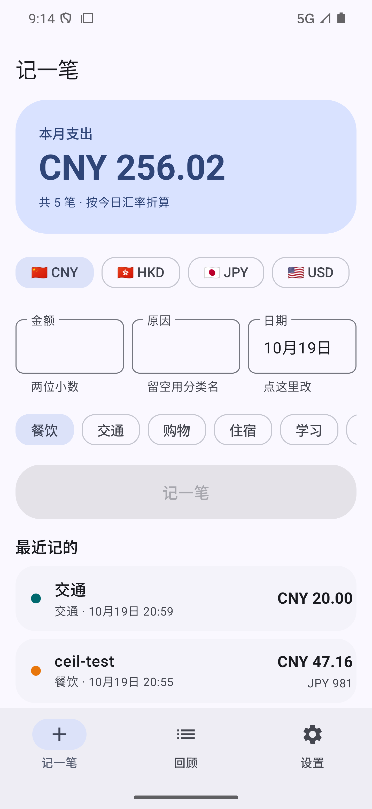
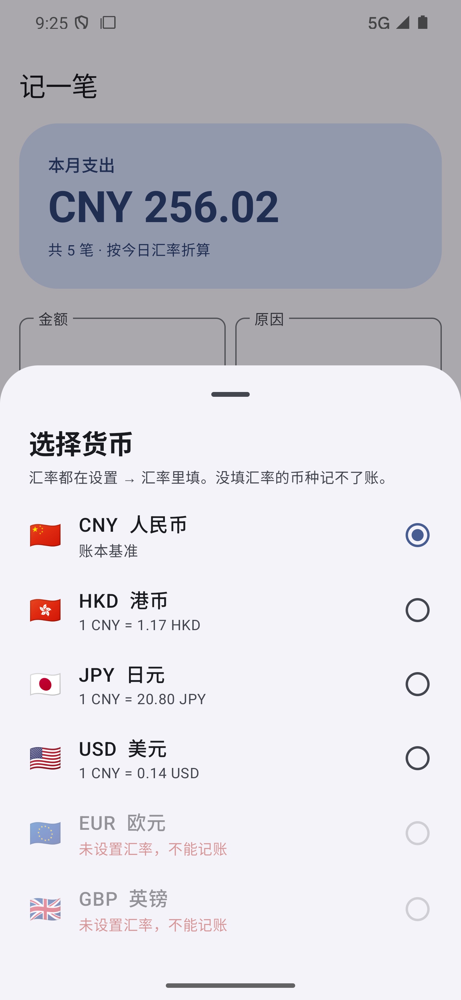
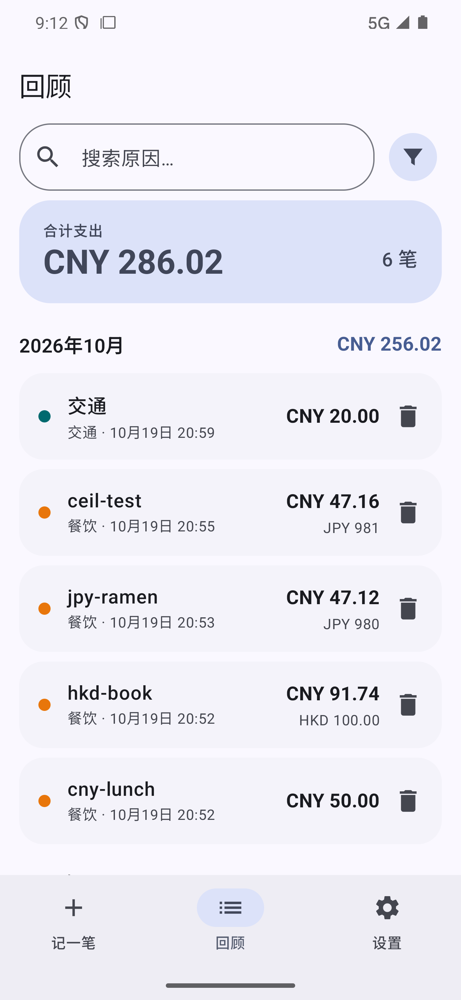
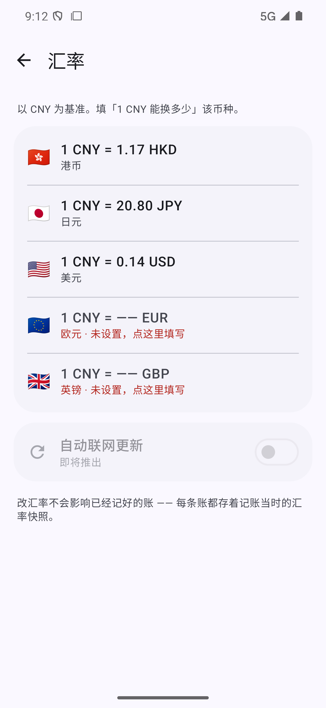
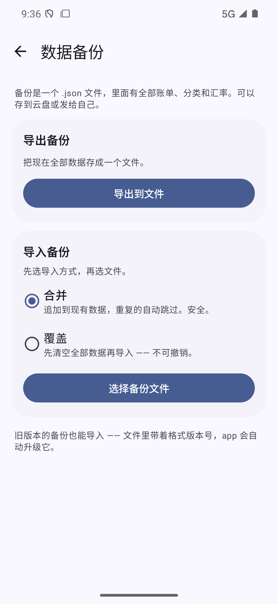
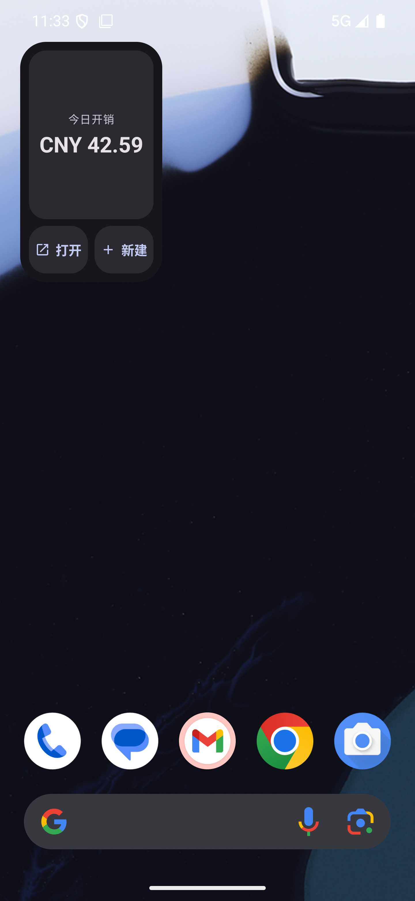
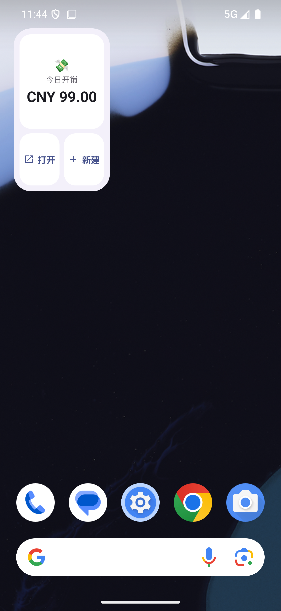

# 荷包 · HoBao

**一个不联网的安卓记账 app。** 多币种、手动汇率、JSON 备份与恢复。

> 「荷包」是粤语的"钱包"。这是我从零学安卓开发的第一个完整项目 ——
> 从环境搭建到签名的 APK，每一层都自己走过一遍。

**当前版本**：v0.4 ｜ **最低支持**：Android 8.0（API 26）｜ **安装包**：8.5 MB

### 🎮 [点这里，在浏览器里直接试玩 →](https://henryliu520.github.io/HoBao/)

不用下载、不用登录。网页版照搬真机版的交互（数据只存在你自己的浏览器里）。
真正的安卓版见 [Releases](https://github.com/HenryLiu520/HoBao/releases/latest)。

---

## 截图

| 记一笔 | 选择货币 |
|---|---|
|  |  |

| 回顾（筛选 / 按月分组 / 多币种） | 汇率 |
|---|---|
|  |  |

| 数据备份 | 桌面组件（深色） |
|---|---|
|  |  |

| 桌面组件：今日开销 + 打开 + 新建 |
|---|
|  |

---

## 功能

### 记账
- 金额 / 原因 / **货币** / **日期** 四个输入框，两行两列
- 币种默认跟随"报告币种"，日期默认今天 —— **记一笔普通的账依然是 3 次触达**
- 原因留空自动使用分类名；日期可以往回补记（未来日期禁选）

### 多币种与汇率
- 账本锚点固定为**人民币**，汇率由用户手动填写：`1 CNY = ? 外币`
- 每条账单**冻结记账当时的汇率快照** —— 之后改汇率，历史金额一分不动
- 可以随时切换「报告币种」，只改显示，不改账本
- 汇率没填的币种不允许记账（从根上消除错误）

### 回顾
- 左右分栏的筛选面板：时间（不限/今天/本周/本月/本季/本年/自定义）+ 类别
- 关键词搜索、四种排序、按月分组小计
- 每条记录显示"折算金额 + 原币金额"两行

### 桌面组件
- **2×2 四宫格**：上半「今日开销」（跨两格），左下「打开 app」，右下「＋ 新建」
- 点「新建」弹出**悬浮小窗**直接记账（金额 / 原因 / 货币 / 分类），存完即回桌面，
  不用进 app 主界面
- 组件用的是**人民币口径**，走每笔账冻结的汇率快照 —— 改汇率不影响组件数字
- 记完一笔，组件数字**自动刷新**（app 主动推送，不靠系统定时）
- 遵循 Android 12+ 的组件规范：内外两层圆角取自系统、深浅两套配色、点击有过渡动画

### 数据备份
- 导出 / 导入完整的 JSON 备份（账单 + 分类 + 汇率快照）
- **两种导入方式**：合并（自动判重）/ 覆盖（二次确认）
- **带格式版本号**，旧版本的备份能被新版本自动升级后导入
- 使用官方 SAF 读写文件，**不申请任何存储权限**

---

## 技术栈

| 层 | 用什么 |
|---|---|
| 语言 / UI | Kotlin 2.2.10 + Jetpack Compose + Material 3 |
| 架构 | MVVM + Repository + 单向数据流 |
| 存储 | Room 2.8.5（3 张表：账单 / 分类 / 货币） |
| 导航 | Navigation Compose（一级页签 + 二级页面） |
| 构建 | AGP 9.4.1 / Gradle 9.8.1 / KSP |
| 桌面组件 | AppWidgetProvider + RemoteViews（跨进程 UI） |
| 图标 | Material Symbols Outlined（Apache 2.0，脚本自动拉取） |

几个刻意的技术决定：

- **金额用整数最小单位存**（分），不用浮点数 —— `0.1 + 0.2 = 0.30000000000000004`
- **汇率快照随账单冻结** —— "冻结的是汇率，不是结果"，折算值由快照唯一确定，所以不另存一份
- **汇率基准与显示币种分离** —— 账本层永不变，显示层随汇率变
- **货币一律用 ISO 4217 代码**（CNY / HKD / JPY），不用符号 —— `¥` 同时是人民币和日元

---

## 项目结构

```
.
├── HoBao/                    # Android 工程（用 Android Studio 打开这个子目录）
│   └── app/src/main/java/com/liuhaoran/hobao/
│       ├── data/             # Room 实体 / DAO / 仓库 / 备份编解码
│       ├── model/            # 时间筛选、排序
│       ├── ui/               # Compose 页面、组件、主题
│       ├── util/             # 金额格式化、货币换算、国旗
│       ├── viewmodel/        # 全 app 共用的状态中心
│       ├── quickadd/         # 悬浮记账小窗（透明 Activity）
│       └── widget/           # 桌面组件：provider + 数据快照 + 刷新
├── tools/                    # 图标下载脚本（Material Symbols → vector）
└── 文档/                     # 开发过程记录（见下方索引）
```

### 文档索引

| 文件 | 内容 |
|---|---|
| `00-开发流程地图.md` | 从 0 到上线的 6 个阶段 |
| `01-需求清单.md` | 用户故事与优先级 |
| `02-数据模型.md` | 三张表、字段与设计取舍 |
| `03-页面地图.md` | 页面结构、跳转与触达次数 |
| `04-阶段3-纵向切片.md` | Room 接入、单向数据流 |
| `05-教学协议.md` | 这个项目是怎么被"带着做"的 |
| `06-筛选面板.md` | 筛选面板的设计与实现 |
| `07-汇率与多币种-规格.md` | 汇率规格定稿 |
| `08-汇率与多币种-实现与验收.md` | 汇率实现与逐项验收 |
| `09-补记日期与原因回退.md` | 日期选择、标签统一、输入框布局 |
| `10-货币显示规范.md` | 全局货币显示约定 |
| `11-数据备份.md` | JSON 备份、格式版本化、导入语义 |
| `12-桌面组件.md` | App Widget、RemoteViews、四宫格、Material 3 美化 |
| `14-图标规范.md` | 图标从哪来、脚本怎么用、坐标系坑 |

---

## 构建

```bash
# 需要 JDK 17+ 和 Android SDK（compileSdk 37）
cd HoBao
./gradlew assembleDebug        # 或 assembleRelease
```

发布包需要签名。仓库里**不包含**签名密钥和密码（见 `.gitignore`），
所以别人 clone 下来只能构建 debug 或未签名的 release 包 —— 这是故意的。

---

## 数据与隐私

- **完全离线**：没有网络权限，没有任何上报、统计、广告 SDK
- **网页试玩版**：纯静态页面，数据存在浏览器 `localStorage`，没有任何后端
- **数据只在本机**：存在应用的私有目录里，备份文件由你自己保存到哪就是哪
- **汇率不会自动更新**：全部手动填写，界面里"自动联网更新"是灰的（还没做）

---

## 版权与维护

**版权持有人：柳皓然（LIU Haoran）** — 详见 [`LICENSE`](LICENSE)，**保留所有权利**。

本项目采用「人工触发 + AI 协作」的维护模式：

| 角色 | 职责 |
|---|---|
| 版权持有人（LIU Haoran） | 决定做什么、验收结果、决定何时发布 |
| AI 助手（Hermes） | 实现功能、写文档、验证、提交、打 tag 与发布 |

**工作流**：版权持有人说明需求 → AI 助手在本仓库完成开发与验收 →
经确认后提交并发布新版本。**未经明确指示，不会改动本仓库。**

代码与文档由 AI 助手协作生成，但**全部权利归版权持有人所有**。

> ⚠️ 这个仓库是**公开**的，但**不等于可以自由使用**。
> 没有采用开源许可证 = 默认「保留所有权利」，他人不得复制、修改、再分发或商用。
> 如果你想要一份可以自由使用的实现，请自行从零编写。

---

## 免责声明

- 汇率由用户手动填写，**不是实时市场报价**；所有折算与统计结果**仅供参考**，
  不构成任何财务、税务、投资或会计建议。
- 本软件按"现状"提供，不附带任何担保。使用前请自行备份重要数据。
